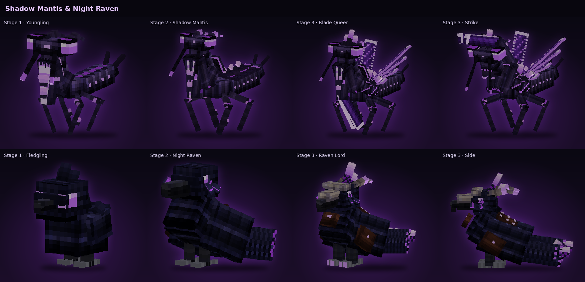

# Companions

A companion is your personal partner: it follows you everywhere, fights at your side, grows with your experience and
can be ridden at its final stage. You can have **one** companion at a time.

## The Geode Keeper

Deep inside **amethyst geodes** there sometimes lives a **Geode Keeper** – an old hermit with crystals on his shoulders
and a staff topped with a cracked geode.

- Every geode has **exactly one chance** to hold a keeper (60 % by default). A soft hum and a message tell you when he
  is near. Geodes are noticed in the overworld below y = 80.
- **Right-click** him: he offers you **one of three companions**, chosen at random. Accept or decline by clicking in chat.
- **Decline** and he disappears – look for another geode and hope for a different offer.
- **Accept** and your companion appears next to him. The keeper then **settles** in his geode for good and stays your
  trading partner.
- Apart from that he **never disappears** on his own. He can be **killed** (40 health, he drops nothing) and moved like
  a villager: push a **boat** or **minecart** into him and he gets in.

### Trading with the Geode Keeper

The keeper trades **like a villager**, using the normal trading screen.

- **Shift + right-click** opens the trades. Once you have a companion, a plain right-click is enough.
- Every trade gives him experience. He climbs **five levels** (Novice → Master, with the same XP thresholds as
  villagers) and unlocks **two new random offers per level** (three at level 1).
- His stock **refills every 10 minutes**. Trades give you experience orbs.
- Trading with him also makes him settle in his geode.
- Keepers appear for **every** player – also for those who already have a companion.

| Level | Possible offers (a random selection appears) |
|---|---|
| 1 | 6 amethyst shards → 2 Resonance Treats · 4 shards → 1 amethyst cluster · 16 calcite → 3 shards · 16 smooth basalt → 3 shards · 1 emerald → 6 shards |
| 2 | 12 shards → 3 bottles o' enchanting · 8 shards → 4 tinted glass · 10 shards → 2 large amethyst buds · 16 shards → name tag · 12 glow berries → 4 shards |
| 3 | 24 shards → Resonance Igniter · 20 shards + 2 emeralds → spyglass · 16 shards → 8 Resonance Treats · 1 echo shard → 16 shards |
| 4 | 32 shards → 4 glow crystals · 24 shards + 2 emeralds → 4 crystal lanterns · 32 shards + 8 emeralds → 16 bottles o' enchanting |
| 5 | 64 shards + 4 diamonds → **budding amethyst** · 64 shards + 2 emerald blocks → Totem of Undying |

Amethyst Cores, Wireless Cores and network upgrades are not for sale – you earn them from the bosses.

## The three companions

| | Shadow Mantis | Amethyst Shroom | Night Raven |
|---|---|---|---|
| Role | fighter | healer | carrier |
| Damage (of the mantis) | 100 % | 25 % | 70 % |
| Attacks every | 1.3 s | 2.0 s | 1.1 s |
| Health (stage 1 / 2 / 3) | 20 / 40 / 70 | 20 / 30 / 45 | 18 / 32 / 50 |
| Armor (stage 1 / 2 / 3) | 0 / 4 / 8 | 0 / 0 / 0 | 0 / 2 / 4 |
| Damage (stage 1 / 2 / 3) | 4 / 7 / 11 | 1 / 1.75 / 2.75 | 2.8 / 4.9 / 7.7 |
| Stage 1 | walks with you | sits on your shoulder, does not fight | sits on your shoulder, flies off to fight |
| In your base | +50 % damage, can stand guard | crops grow faster (stage 2+), you can fly (stage 3) | – |
| Extra | – | – | exploration trips |
| Rideable at stage 3 | ground + short flights | – | permanent flight |

### Shadow Mantis

A pitch-black praying mantis with glowing slit eyes, serrated claws and swept-back horns. It attacks whatever you attack
or whatever attacks you, and monsters near you (it leaves creepers alone).

- **Stage 1 – Youngling.**
- **Stage 2:** dorsal spikes, a cobra hood and leather wings; armor 4, more damage and knockback.
- **Stage 3 – Blade Queen:** spiked pauldrons, a crown, amethyst scythes and crystal wings; armor 8. Its **scythe strike**
  also hits monsters around the target.
- **Riding (stage 3):** right-click to mount. Hold **Space** to fly for about 4 seconds; then it glides down and recharges
  on the ground.
- **In your base** (see [Your base](#your-base)) it fights **50 % harder**.
- **Base guard:** tell it to *stay* (G key, right-click or the menu) while it is in your base and it stands guard instead
  of sitting down: it patrols around the terminal and attacks every monster within 24 blocks of it – also while you are
  away. Outside the base, *stay* simply makes it sit.

### Amethyst Shroom

A mushroom on two legs with glowing spots on its cap. It heals you when you are hurt.

- **Stage 1:** it sits on your **right shoulder** and does not fight yet (it still heals). Tell it to stay and it jumps
  down and sits.
- **Fights from stage 2, only from a distance:** it keeps away from monsters and hurls spore bolts (up to 10 blocks,
  12 at stage 3).
- **Faster crops (stage 2+):** while it is in [your base](#your-base), crops, stems, berry bushes, cocoa, nether wart,
  saplings, sugar cane, cactus and bamboo there grow about **3× as fast** (stage 3: about 4–5×). Green spores show where it
  helps.
- **Flight in your base (stage 3):** while you are in your base and your shroom is with you (within 48 blocks, not
  exhausted), you can **fly like in creative mode**. Leave the base and the flight ends – you get Slow Falling for a soft
  landing.

- **H** heals right away, **Shift + H** switches between *automatic* and *on key*. After healing it needs a break:
  **30 / 20 / 15 seconds** at stage 1 / 2 / 3.
- **Stage 1:** Regeneration once you have lost 2 hearts.
- **Stage 2:** 2 hearts instantly + Regeneration, also for your pets and other companions nearby.
- **Stage 3** (now with a leather backpack and a glowing healing potion): 3 hearts + Regeneration II, removes poison and wither, heals all players nearby. **Emergency heal:**
  below 30 % health it saves you with 4 hearts (every 60 s, automatic mode only – unless it has the *Lifesaver* talent).

### Night Raven

A jet-black raven with glowing eyes, a spiky ruff and a courier bag. At stage 3 (**Raven Lord**) it wears a bone mask,
horns, a crystal crest and a saddle.

- **Stage 1:** it sits on your **left shoulder**. When there is something to fight it flies off, attacks, and returns to
  your shoulder shortly after the fight.
- **Collects items** around you into its bag: **9 / 18 / 27 slots** and a radius of **3 / 5 / 8 blocks** at stage 1 / 2 / 3.
  Items you just dropped yourself are left alone for 30 seconds.
- **Right-click it with a bound Storage Key** to link it to your terminal. When the bag is two-thirds full it flies the
  items there (invisible while it is away) and comes back. Clicking with the key again sends it right away.
- **Shift + right-click** opens its bag.
- **Exploration trips:** press *Explore* in the companion menu and it flies off for **4 minutes** (shorter with the
  *Swift Delivery* talent). It brings back **3 / 4 / 5 finds** at stage 1 / 2 / 3 (+1 with *Lucky Find*) into its bag – if
  the bag is full, into your inventory. Afterwards it rests for **5 minutes**.

  | Stage | Typical finds |
  |---|---|
  | 1 | raw copper, copper ingots, raw iron, iron ingots and nuggets, coal, flint, feathers, string, amethyst shards, sweet berries |
  | 2 | + raw gold, gold ingots and nuggets, emeralds, lapis lazuli, redstone, glow berries, rarely a name tag or a saddle |
  | 3 | + diamonds, emeralds, obsidian, ender pearls, bottles o' enchanting, golden apples, rarely an echo shard |

  The first find always comes from its own stage, and finds of its own stage are the most common.
- **Riding (stage 3):** right-click to mount. It flies where you look for as long as you like; Space rises, Sneak
  dismounts.
- **Passive abilities** – always active, stronger with every level:

  | Ability | Effect | Level 1 → 100 |
  |---|---|---|
  | **Crow Scatter** | when hit, it sometimes bursts into a swarm of crows, takes no damage and reassembles a few blocks away (at most every 3 s) | 10 % → 35 % |
  | **Scout Crows** | three small shadow crows circle you, make monsters around you glow for 6 s and caw a warning when a creeper is behind you | every 30 s → 20 s, radius 12 → 22 blocks |
  | **Guardian Crow** | a crow throws itself in front of arrows and other projectiles aimed at you (at most every 2 s, within 24 blocks of the raven) | 15 % → 35 % |
  | **Crow Double** | a hit that would kill you makes you burst into crows instead: a dark violet shadow decoy of you stays for 6 s and draws all monsters within 16 blocks, you reappear 5–8 blocks away with 4 hearts, invisible and with Resistance II for 3 s (raven within 32 blocks; not against the void or `/kill`) | every 10 min → 6 min |

## Your base

Your **base** is the area of **3 × 3 chunks** around a Storage Terminal that **you** placed (the terminal's chunk and the
eight chunks around it). Several terminals give you several bases. The companion menu shows when your companion is in
your base.

| Companion | In your base |
|---|---|
| Shadow Mantis | +50 % damage; *stay* = stand guard |
| Amethyst Shroom | crops grow faster (stage 2+); you can fly (stage 3) |

## Growing up

- **Half of all experience** you collect goes to your companion (if it follows you and is within 32 blocks).
- It levels like a player and reaches **stage 2 at level 30** and **stage 3 at level 100** – each with a new look, more
  health and stronger abilities. Both levels are [configurable](15-configuration.md).
- **Resonance Treat** (honey bottle + 2 amethyst shards → 4): right-click your companion for **5 minutes of double
  experience** (feed more to stack up to 15 minutes), a minute of speed, 2 hearts and an end to its exhaustion.
- It **never dies**. If it takes too much damage it is **exhausted** for 45 seconds, stops fighting and recovers. If it
  falls into the void it is brought back to you.

## Following, staying and calling

- It follows you **everywhere** – through portals, into other dimensions and after you respawn.
- **Right-click** or the **G** key (up to 48 blocks away) toggles **follow / stay**. At stage 3, right-click on the mantis
  or raven mounts it instead, so use G. A companion on your shoulder can't be clicked – use G or the menu.
- The Shadow Mantis stands **guard** instead of sitting when you tell it to stay inside your base.
- `/jtechstorage companion call` – or *Call* in the menu – brings it to you, even from another dimension or from chunks
  that are no longer loaded (it is fetched from its last position, which can take a moment).
- It only joins you where there is solid ground. While you fly over the void or high in the air it waits and comes as
  soon as you have landed. Companions take no fall damage.
- An **exhausted** companion is ignored by monsters until it has recovered.
- `/jtechstorage companion release confirm` releases it for good.

## Companion menu

Press **K** (or Shift + right-click the mantis or shroom) to open the menu. It works from any distance.

**Overview tab**

- a live portrait of your companion (when it is nearby),
- level, experience and health bars, damage, armor, attack speed, mode and stance,
- buttons: **Follow/Stay**, **Stance**, **Call**, **HUD on/off**; the shroom adds *Heal now* and its heal mode, the raven
  has *Bag* and *Explore*.
- whether it is in your base, on your shoulder, guarding or exploring (with the remaining time).

**Stances**

| Stance | Behaviour |
|---|---|
| Aggressive | attacks what you attack, what attacks you, and every monster near you (default) |
| Defensive | only defends you and itself |
| Passive | does not fight at all |

**Look tab** – see [Customization](#customization).

## Customization

The **Look** tab of the companion menu changes how your companion looks. A large live portrait shows every change right
away. Use the arrows to switch; locked options are skipped and the tooltip lists every option with its requirement.

| Option | Choices | Unlock |
|---|---|---|
| Coloring | Amethyst · Frost · Ember · Jade · Gold · Soulbond | Frost level 20, Ember 200 defeated monsters, Jade level 50, Gold stage 3 + level 100, Soulbond bond *Soulmate* |
| Horns (mantis) · Tail (raven) · Cap (shroom) | swept / crown / sickles · fan / long / forked · tiered / witch hat / flat | 2nd form level 30, 3rd form level 60 |
| Wings (mantis) · Crest (raven) · Back (shroom) | crystal / leather / none · crystal / feathers / none · backpack / cape / nothing | stage 3 |
| Glow color | any color from the color bar, default, white, Soul Pink | level 10 (Soul Pink: bond *Soulmate*) |

### Equipment

Three visible slots: **collar**, **amulet** and **armor**. Each can show any unlocked material, *Automatic* (the best
one) or nothing. The **bonus always comes from the best unlocked material**, no matter what you show.

| Material | Unlock | Collar | Armor | Amulet: mantis / shroom / raven |
|---|---|---|---|---|
| Iron | level 10 | +10 % health | +2 armor | +5 % damage / +10 % healing / +1 block collection radius |
| Gold | level 25 | +20 % | +4 | +10 % / +20 % / +2 |
| Diamond | level 45, stage 2 | +30 % | +6 | +15 % / +30 % / +3 |
| Netherite | level 70 | +40 % | +8, toughness 2 | +20 % / +40 % / +4 |
| Amethyst Obsidian | level 100, stage 3 | +50 % | +10, toughness 3 | +25 % / +50 % / +5 |

Server owners can turn the bonuses off with `companions.equipment` in the [configuration](15-configuration.md); the
equipment is then only cosmetic.

## Bond

Your companion grows closer to you the more time you spend with it. The bond **never decreases**.

| Stage | Points | Unlocks |
|---|---|---|
| Stranger | 0 | – |
| Familiar | 100 | gesture *Happy Hop* |
| Friend | 300 | gesture *Nuzzle* (on your shoulder it rubs its cheek against you) |
| Partner | 600 | its own gesture: mantis *Blade Salute*, shroom *Shroom Dance*, raven *Bow* |
| Soulmate | 1000 | coloring **Soulbond**, glow color **Soul Pink** and a pink **aura** (switch it off in the *Look* tab) |

How to build it:

| Action | Bond | Limit |
|---|---|---|
| Feed its **favorite food of the day** (see the menu) | +25 | once a day |
| Feed other food of its kind | +3 | five times a day |
| **Pet** it (button in the menu, up to 8 blocks away) | +5 | once per minute, ten times a day |
| **Play fetch**: throw a stick or an amethyst shard with Q near it | +10 | ten times a day |

Food: mantis – raw beef, porkchop, mutton, chicken, rabbit, cod, salmon; shroom – sweet berries, glow berries, bone
meal, brown and red mushrooms; raven – wheat, pumpkin, melon and beetroot seeds, gold nuggets. Feeding also heals it a
little. A happy companion shows its gestures by itself; the *Look* tab plays any unlocked gesture on click. The menu
shows the bond stage with a progress bar, the HUD shows it as ❤ next to the level.

## Talent tree

- You get **1 talent point every 4 levels** – 25 points at level 100, up to **30** at level 120.
- Every species has **three branches with five talents**. A talent needs at least one point in the talent above it, and
  the lower talents need **stage 2 or 3**. The fifth talent of each branch is a master talent for stage 3.
- The fourth branch, **Special**, holds three **special attacks**. You can learn **only one** of them (reset the talents to
  switch). Below them, **Mastery** (2 ranks: +25 % power and −20 % cooldown per rank) and **Instinct** (uses the special
  attack on its own in danger) improve the one you chose.
- Talents you can learn right now glow green in the *Talents* tab; hover for the exact effect, click to learn.
- **Reset** gives all points back and costs **1 Amethyst Core** (free in creative mode).

## Special attacks

Learn a special attack in the *Special* branch (from stage 2) and trigger it in combat with the **B** key (changeable),
or with the *Special* button in the companion menu. It hits the monster you are looking at – otherwise your companion's
current target, the monster you last hit, or the nearest monster. The HUD shows a small bar under the companion icon
that turns gold when the special attack is ready.

| Companion | Special attack | Effect | Cooldown |
|---|---|---|---:|
| Shadow Mantis | **Paralyzing Sting** | leaps at the target, 150 % damage, **stunned for 5 s**, poisoned for 30 s | 60 s |
| Shadow Mantis | **Blade Storm** | spins for 1.5 s: three slashes against all monsters within 4 blocks, with knockback | 45 s |
| Shadow Mantis | **Execution** | leaps at the target, 250 % damage – doubled below 35 % health | 40 s |
| Amethyst Shroom | **Spore Veil** | you and the shroom are **invisible for 60 s**, monsters lose track of you; its cooldowns are halved and run twice as fast | 3 min |
| Amethyst Shroom | **Life Bloom** | a healing circle of 6 blocks for 10 s: 1 heart and Regeneration every second for you and your allies | 2 min |
| Amethyst Shroom | **Paralysis Cloud** | spore cloud at the target: 4 damage, Slowness III, Weakness II and Poison for 8 s within 5 blocks | 90 s |
| Night Raven | **Raven Swarm** | **five shadow ravens** circle above the target and dive at it one after another, each hitting for 150 % damage | 90 s |
| Night Raven | **Shadow Dive** | dives at the target itself: 300 % damage, Blindness for 5 s, knockback | 40 s |
| Night Raven | **Terror Cry** | monsters within 10 blocks back off, lose their target and are slowed, weakened and glowing for 8 s | 90 s |

Mastery raises damage, stun and effect durations by 25 % per rank and cuts the cooldown by 20 % per rank.

<!-- talents:start -->
### Shadow Mantis

**Blade**

| Talent | Ranks | From stage | Effect |
|---|---:|---:|---|
| ⚔ Sharp Blades | 3 | 1 | +8% damage per rank. |
| » Quick Strike | 2 | 1 | Attacks 8% faster per rank. |
| ✦ Precision | 2 | 2 | 10% chance per rank to deal double damage. |
| ☼ Whirling Scythe | 1 | 3 | The scythe strike hits monsters around the target with full instead of half damage and in a wider circle. |
| ♨ Bloodlust | 1 | 3 | Every kill makes her attack 15% faster for 5 s (stacks up to 3 times). |

**Armor**

| Talent | Ranks | From stage | Effect |
|---|---:|---:|---|
| ◆ Chitin Shell | 3 | 1 | +2 armor per rank. |
| ▣ Crystal Plates | 2 | 1 | +10% health per rank. |
| ✶ Thorns | 2 | 2 | Reflects 15% of melee damage per rank back at the attacker. |
| ♥ Unbreakable | 1 | 3 | Once every 5 minutes she stays on her feet with half health instead of being exhausted and gets Resistance II for a moment. |
| ❖ Crystal Skin | 1 | 3 | 20% chance to block a hit completely. |

**Hunt**

| Talent | Ranks | From stage | Effect |
|---|---:|---:|---|
| » Swift Legs | 2 | 1 | +7% speed per rank. |
| ◎ Hunting Instinct | 2 | 1 | Hunts monsters 4 blocks further around you per rank (normally 16). |
| ↑ Leap Attack | 1 | 2 | Leaps at targets 4–10 blocks away (every 4 s). |
| ✧ Crystal Flight | 2 | 3 | +50% flight stamina per rank while you ride her. |
| ☠ Predator | 1 | 3 | +30% damage against targets below half health. |

**Special**

*Pick **one** of the first three – that is your special attack (B key). Mastery and Instinct improve it.*

| Talent | Ranks | From stage | Effect |
|---|---:|---:|---|
| ✹ Paralyzing Sting | 1 | 2 | SPECIAL ATTACK: leaps at the target and stings (150% damage). The target is stunned for 5 s and poisoned for 30 s. Cooldown 60 s. |
| ✺ Blade Storm | 1 | 2 | SPECIAL ATTACK: spins for 1.5 s – three slashes, each hits all monsters within 4 blocks and knocks them back. Cooldown 45 s. |
| ⚡ Execution | 1 | 2 | SPECIAL ATTACK: leaps at the target and strikes for 250% damage – double against targets below 35% health. Cooldown 40 s. |
| ★ Mastery | 2 | 3 | The special attack is 25% stronger and recharges 20% faster per rank. |
| ☯ Instinct | 1 | 3 | Uses the special attack on its own when you drop below 30% health or at least 3 monsters surround you. |

### Amethyst Shroom

**Healing**

| Talent | Ranks | From stage | Effect |
|---|---:|---:|---|
| ♥ Strong Spores | 3 | 1 | Heals 15% more per rank. |
| » Fast Bloom | 2 | 1 | Heal cooldown 12% shorter per rank. |
| ◎ Wide Spores | 2 | 2 | Heals 3 blocks further per rank. |
| ✚ Lifesaver | 1 | 3 | The emergency heal comes twice as often (every 30 s) and also works in key mode. |
| ❀ Second Life | 1 | 3 | Saves you from death once every 10 minutes: 4 hearts, Regeneration II and Absorption (if it is within 32 blocks). |

**Protection**

| Talent | Ranks | From stage | Effect |
|---|---:|---:|---|
| ▮ Tough Stalk | 3 | 1 | +10% health per rank. |
| ◆ Spore Shield | 2 | 1 | Healed allies get Absorption for 10 s (strength = rank). |
| ☁ Calm Aura | 2 | 2 | Healed allies get 5 s of Resistance per rank. |
| ✧ Purify | 1 | 3 | Healing removes all harmful effects. |
| ▣ Mushroom Skin | 1 | 3 | You have Resistance I while it is within 12 blocks of you. |

**Poison**

| Talent | Ranks | From stage | Effect |
|---|---:|---:|---|
| ☠ Toxic Spores | 3 | 1 | Hits poison for 2 s per rank. |
| ✶ Spore Burst | 2 | 1 | +15% damage per rank. |
| ❄ Numbing Spores | 2 | 2 | Hits slow the target for 2 s per rank. |
| ☣ Toxic Cloud | 1 | 3 | Every heal gives monsters within 5 blocks Poison II. |
| ⁂ Spore Field | 1 | 3 | Monsters within 4 blocks of it are poisoned every 5 s. |

**Special**

*Pick **one** of the first three – that is your special attack (B key). Mastery and Instinct improve it.*

| Talent | Ranks | From stage | Effect |
|---|---:|---:|---|
| ◌ Spore Veil | 1 | 2 | SPECIAL ATTACK: you and your shroom are invisible for 60 s and monsters lose track of you. Its cooldowns are halved and run twice as fast meanwhile. Cooldown 3 min. |
| ✿ Life Bloom | 1 | 2 | SPECIAL ATTACK: a healing circle (6 blocks) for 10 s: 1 heart and Regeneration every second for you, players, companions and your pets. Cooldown 2 min. |
| ☁ Paralysis Cloud | 1 | 2 | SPECIAL ATTACK: a spore cloud at the target: 4 damage, Slowness III, Weakness II and Poison for 8 s to all monsters within 5 blocks. Cooldown 90 s. |
| ★ Mastery | 2 | 3 | The special attack is 25% stronger and recharges 20% faster per rank. |
| ☯ Instinct | 1 | 3 | Uses the special attack on its own when you drop below 30% health or at least 3 monsters surround you. |

### Night Raven

**Bag**

| Talent | Ranks | From stage | Effect |
|---|---:|---:|---|
| ◎ Keen Eye | 3 | 1 | Collects items 1.5 blocks further per rank. |
| ✉ Eager Courier | 2 | 1 | Flies to the terminal when the bag is half (rank 2: a third) full instead of two thirds. |
| » Swift Delivery | 2 | 2 | Returns from deliveries and exploration trips 25% faster per rank. |
| ✦ Lucky Find | 1 | 3 | Brings back a few amethyst shards from 30% of deliveries, and one extra find from every exploration trip. |
| ◈ Treasure Hunter | 1 | 3 | Exploration: 25% of finds from the next stage (at stage 3: 10% chance for netherite scrap) and a 40% shorter rest. |

**Combat**

| Talent | Ranks | From stage | Effect |
|---|---:|---:|---|
| ⚔ Sharp Beak | 3 | 1 | +10% damage per rank. |
| ↓ Dive | 2 | 1 | Attacks 10% faster per rank. |
| ◉ Eye Peck | 2 | 2 | 10% chance per rank to blind and weaken the target for 3 s. |
| ☾ Shadow Swarm | 1 | 3 | 20% chance per hit: shadow crows deal 3 damage to monsters around the target. |
| ♪ Raven Call | 1 | 3 | 15% chance per hit to call a shadow raven that dives at the target. |

**Flight**

| Talent | Ranks | From stage | Effect |
|---|---:|---:|---|
| ≈ Tailwind | 3 | 1 | +7% speed per rank (also while riding). |
| ❦ Feather Fall | 2 | 1 | When you fall more than 6 (rank 2: 3) blocks, you get Slow Falling. |
| ◐ Night Eye | 1 | 2 | Makes monsters within 16 blocks of you glow briefly every 10 s. |
| ♛ Sky Lord | 2 | 3 | Flies 20% faster per rank while you ride it. |
| ☽ Night Wings | 1 | 3 | Night Vision for you while it is dark around you and it is nearby. |

**Special**

*Pick **one** of the first three – that is your special attack (B key). Mastery and Instinct improve it.*

| Talent | Ranks | From stage | Effect |
|---|---:|---:|---|
| ⁂ Raven Swarm | 1 | 2 | SPECIAL ATTACK: five shadow ravens circle above the target and dive at it one after another – each hits for 150% damage. Cooldown 90 s. |
| ↯ Shadow Dive | 1 | 2 | SPECIAL ATTACK: dives at the target itself – 300% damage, 5 s of Blindness and knockback. Cooldown 40 s. |
| ! Terror Cry | 1 | 2 | SPECIAL ATTACK: a piercing cry: monsters within 10 blocks back off, lose their target and are slowed, weakened and glowing for 8 s. Cooldown 90 s. |
| ★ Mastery | 2 | 3 | The special attack is 25% stronger and recharges 20% faster per rank. |
| ☯ Instinct | 1 | 3 | Uses the special attack on its own when you drop below 30% health or at least 3 monsters surround you. |
<!-- talents:end -->

## HUD

A small display in the top left corner shows your companion at a glance:

- species, stage, name and level,
- health and experience bars,
- follow / stay / guard / on your shoulder / away / exploring / exhausted, the stance and the remaining treat time,
- the shroom's heal cooldown, the raven's bag fill, or the mantis' flight stamina while you ride it,
- the distance (or "other dimension") when it is far away.

For the Night Raven the HUD also shows ✧ – violet when the *Crow Double* is ready, otherwise the minutes until it is.

Switch it off with the *HUD* button in the companion menu (saved per player).

## Commands

| Command | Who | Effect |
|---|---|---|
| `/jtechstorage companion call` | everyone | bring your companion to you |
| `/jtechstorage companion release confirm` | everyone | release your companion for good |
| `/jtechstorage companion accept` / `decline` | everyone | answer a keeper's offer (the chat buttons do this) |
| `/jtechstorage companion keeper` | operators | spawn a Geode Keeper in front of you |
| `/jtechstorage companion xp <amount>` | operators | give your companion experience |

---

[← Phoenix mail and travel](06-phoenix.md) · [Guide overview](README.md) · Next: [Resonance Storm →](08-resonance-storm.md)
