# Recipes

> Every crafting and smithing recipe of JTechStorage. Generated from the recipe files of the mod, so it always matches the current version. In game, the **Recipe Book** shows the same recipes, and with **JEI** you can look them up and transfer them into the Crafting Terminal.

Some items have **no recipe** and only come from bosses or helpers – see [Items without a recipe](#items-without-a-recipe).

## Contents

- [Storage network](#storage-network)
- [Network displays](#network-displays)
- [Building tools](#building-tools)
- [Amethyst chests](#amethyst-chests)
- [Helpers and their homes](#helpers-and-their-homes)
- [Phoenix mail and travel](#phoenix-mail-and-travel)
- [Farm tools](#farm-tools)
- [Crystal Depths](#crystal-depths)
- [Bosses and the End](#bosses-and-the-end)
- [Amethyst Obsidian gear](#amethyst-obsidian-gear)
- [Backpacks](#backpacks)
- [Companions](#companions)
- [Books](#books)
- [Extra vanilla recipes](#extra-vanilla-recipes)
- [Items without a recipe](#items-without-a-recipe)

## Storage network

### Storage Terminal

<table><tr><td>

<table>
<tr><td align="center" width="72">Polished Deepslate</td><td align="center" width="72">Block of Amethyst</td><td align="center" width="72">Polished Deepslate</td></tr>
<tr><td align="center" width="72">Block of Redstone</td><td align="center" width="72">Chest</td><td align="center" width="72">Block of Redstone</td></tr>
<tr><td align="center" width="72">Polished Deepslate</td><td align="center" width="72">Diamond</td><td align="center" width="72">Polished Deepslate</td></tr>
</table>

</td><td align="center" width="40">➜</td><td align="center" width="96">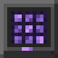 Storage Terminal</td></tr></table>

### Crafting Terminal

**Shapeless:** Storage Terminal + Crafter ➜ 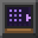 **Crafting Terminal**

### Storage Key

<table><tr><td>

<table>
<tr><td align="center" width="72">Amethyst Shard</td></tr>
<tr><td align="center" width="72">Ender Pearl</td></tr>
<tr><td align="center" width="72">Gold Ingot</td></tr>
</table>

</td><td align="center" width="40">➜</td><td align="center" width="96"> Storage Key</td></tr></table>

### Wireless Terminal

<table><tr><td>

<table>
<tr><td align="center" width="72">Block of Amethyst</td><td align="center" width="72">Eye of Ender</td><td align="center" width="72">Block of Amethyst</td></tr>
<tr><td align="center" width="72">Polished Deepslate</td><td align="center" width="72">Diamond</td><td align="center" width="72">Polished Deepslate</td></tr>
<tr><td align="center" width="72">Polished Deepslate</td><td align="center" width="72">Block of Redstone</td><td align="center" width="72">Polished Deepslate</td></tr>
</table>

</td><td align="center" width="40">➜</td><td align="center" width="96">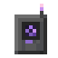 Wireless Terminal</td></tr></table>

### Wireless Terminal (installs the Wireless Core)

**Crafting grid (shapeless):** Wireless Terminal + Wireless Core ➜  **Wireless Terminal** — contents and enchantments are kept

### Team Terminal

<table><tr><td>

<table>
<tr><td align="center" width="72">Gold Ingot</td><td align="center" width="72">Bell</td><td align="center" width="72">Gold Ingot</td></tr>
<tr><td align="center" width="72">Block of Amethyst</td><td align="center" width="72">Lectern</td><td align="center" width="72">Block of Amethyst</td></tr>
<tr><td align="center" width="72">Polished Deepslate</td><td align="center" width="72">Block of Redstone</td><td align="center" width="72">Polished Deepslate</td></tr>
</table>

</td><td align="center" width="40">➜</td><td align="center" width="96">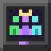 Team Terminal</td></tr></table>

### Trade Terminal

<table><tr><td>

<table>
<tr><td align="center" width="72">Polished Deepslate</td><td align="center" width="72">Block of Emerald</td><td align="center" width="72">Polished Deepslate</td></tr>
<tr><td align="center" width="72">Block of Amethyst</td><td align="center" width="72">Barrel</td><td align="center" width="72">Block of Amethyst</td></tr>
<tr><td align="center" width="72">Polished Deepslate</td><td align="center" width="72">Block of Redstone</td><td align="center" width="72">Polished Deepslate</td></tr>
</table>

</td><td align="center" width="40">➜</td><td align="center" width="96">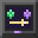 Trade Terminal</td></tr></table>

### Range Upgrade (Gold)

<table><tr><td>

<table>
<tr><td align="center" width="72">Amethyst Shard</td><td align="center" width="72">Block of Gold</td><td align="center" width="72">Amethyst Shard</td></tr>
<tr><td align="center" width="72">Block of Gold</td><td align="center" width="72">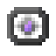 Range Upgrade (Iron)</td><td align="center" width="72">Block of Gold</td></tr>
<tr><td align="center" width="72">Amethyst Shard</td><td align="center" width="72">Block of Gold</td><td align="center" width="72">Amethyst Shard</td></tr>
</table>

</td><td align="center" width="40">➜</td><td align="center" width="96">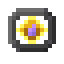 Range Upgrade (Gold)</td></tr></table>

### Range Upgrade (Diamond)

<table><tr><td>

<table>
<tr><td align="center" width="72">Block of Amethyst</td><td align="center" width="72">Diamond</td><td align="center" width="72">Block of Amethyst</td></tr>
<tr><td align="center" width="72">Diamond</td><td align="center" width="72"> Range Upgrade (Gold)</td><td align="center" width="72">Diamond</td></tr>
<tr><td align="center" width="72">Block of Amethyst</td><td align="center" width="72">Diamond</td><td align="center" width="72">Block of Amethyst</td></tr>
</table>

</td><td align="center" width="40">➜</td><td align="center" width="96">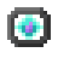 Range Upgrade (Diamond)</td></tr></table>

### Range Upgrade (Netherite)

**Smithing table:** Netherite Upgrade (Smithing Template) + Range Upgrade (Diamond) + Netherite Ingot ➜ 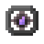 **Range Upgrade (Netherite)**

### Ender Upgrade

<table><tr><td>

<table>
<tr><td align="center" width="72">Eye of Ender</td><td align="center" width="72">Shulker Shell</td><td align="center" width="72">Eye of Ender</td></tr>
<tr><td align="center" width="72">Shulker Shell</td><td align="center" width="72"> Range Upgrade (Netherite)</td><td align="center" width="72">Shulker Shell</td></tr>
<tr><td align="center" width="72">Eye of Ender</td><td align="center" width="72">Nether Star</td><td align="center" width="72">Eye of Ender</td></tr>
</table>

</td><td align="center" width="40">➜</td><td align="center" width="96">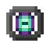 Ender Upgrade</td></tr></table>

### Range Upgrade (Crystal)

<table><tr><td>

<table>
<tr><td align="center" width="72"> Pure Amethyst</td><td align="center" width="72"> Glow Crystal</td><td align="center" width="72"> Pure Amethyst</td></tr>
<tr><td align="center" width="72"> Glow Crystal</td><td align="center" width="72"> Ender Upgrade</td><td align="center" width="72"> Glow Crystal</td></tr>
<tr><td align="center" width="72"> Pure Amethyst</td><td align="center" width="72"> Glow Crystal</td><td align="center" width="72"> Pure Amethyst</td></tr>
</table>

</td><td align="center" width="40">➜</td><td align="center" width="96">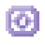 Range Upgrade (Crystal)</td></tr></table>

### Capacity Upgrade (Gold)

<table><tr><td>

<table>
<tr><td align="center" width="72">Chest</td><td align="center" width="72">Block of Gold</td><td align="center" width="72">Chest</td></tr>
<tr><td align="center" width="72">Block of Gold</td><td align="center" width="72">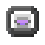 Capacity Upgrade (Iron)</td><td align="center" width="72">Block of Gold</td></tr>
<tr><td align="center" width="72">Chest</td><td align="center" width="72">Block of Gold</td><td align="center" width="72">Chest</td></tr>
</table>

</td><td align="center" width="40">➜</td><td align="center" width="96">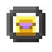 Capacity Upgrade (Gold)</td></tr></table>

### Capacity Upgrade (Diamond)

<table><tr><td>

<table>
<tr><td align="center" width="72">Block of Amethyst</td><td align="center" width="72">Diamond</td><td align="center" width="72">Block of Amethyst</td></tr>
<tr><td align="center" width="72">Diamond</td><td align="center" width="72"> Capacity Upgrade (Gold)</td><td align="center" width="72">Diamond</td></tr>
<tr><td align="center" width="72">Block of Amethyst</td><td align="center" width="72">Diamond</td><td align="center" width="72">Block of Amethyst</td></tr>
</table>

</td><td align="center" width="40">➜</td><td align="center" width="96">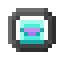 Capacity Upgrade (Diamond)</td></tr></table>

### Capacity Upgrade (Netherite)

**Smithing table:** Netherite Upgrade (Smithing Template) + Capacity Upgrade (Diamond) + Netherite Ingot ➜ 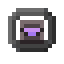 **Capacity Upgrade (Netherite)**

### Capacity Upgrade (Crystal)

<table><tr><td>

<table>
<tr><td align="center" width="72"> Pure Amethyst</td><td align="center" width="72"> Glow Crystal</td><td align="center" width="72"> Pure Amethyst</td></tr>
<tr><td align="center" width="72"> Glow Crystal</td><td align="center" width="72"> Capacity Upgrade (Netherite)</td><td align="center" width="72"> Glow Crystal</td></tr>
<tr><td align="center" width="72"> Pure Amethyst</td><td align="center" width="72"> Glow Crystal</td><td align="center" width="72"> Pure Amethyst</td></tr>
</table>

</td><td align="center" width="40">➜</td><td align="center" width="96"> Capacity Upgrade (Crystal)</td></tr></table>

## Network displays

### Storage Display

<table><tr><td>

<table>
<tr><td align="center" width="72">Amethyst Shard</td><td align="center" width="72">Polished Deepslate</td><td align="center" width="72">Amethyst Shard</td></tr>
<tr><td align="center" width="72">Polished Deepslate</td><td align="center" width="72">Tinted Glass</td><td align="center" width="72">Polished Deepslate</td></tr>
<tr><td align="center" width="72">Redstone Dust</td><td align="center" width="72">Redstone Comparator</td><td align="center" width="72">Redstone Dust</td></tr>
</table>

</td><td align="center" width="40">➜</td><td align="center" width="96"> Storage Display <b>×2</b></td></tr></table>

### Storage Banner

<table><tr><td>

<table>
<tr><td align="center" width="72">Gold Nugget</td><td align="center" width="72">Stick</td><td align="center" width="72">Gold Nugget</td></tr>
<tr><td align="center" width="72">Purple Wool</td><td align="center" width="72">Amethyst Shard</td><td align="center" width="72">Purple Wool</td></tr>
<tr><td align="center" width="72">Purple Wool</td><td align="center" width="72">Redstone Dust</td><td align="center" width="72">Purple Wool</td></tr>
</table>

</td><td align="center" width="40">➜</td><td align="center" width="96"> Storage Banner</td></tr></table>

## Building tools

### Building Wand

<table><tr><td>

<table>
<tr><td align="center" width="72"></td><td align="center" width="72"></td><td align="center" width="72">Block of Amethyst</td></tr>
<tr><td align="center" width="72"></td><td align="center" width="72">Gold Ingot</td><td align="center" width="72"></td></tr>
<tr><td align="center" width="72">Stick</td><td align="center" width="72"></td><td align="center" width="72"></td></tr>
</table>

</td><td align="center" width="40">➜</td><td align="center" width="96">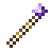 Building Wand</td></tr></table>

### Exchange Wand

<table><tr><td>

<table>
<tr><td align="center" width="72"></td><td align="center" width="72"></td><td align="center" width="72">Block of Amethyst</td></tr>
<tr><td align="center" width="72"></td><td align="center" width="72">Ender Pearl</td><td align="center" width="72"></td></tr>
<tr><td align="center" width="72">Stick</td><td align="center" width="72"></td><td align="center" width="72"></td></tr>
</table>

</td><td align="center" width="40">➜</td><td align="center" width="96">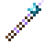 Exchange Wand</td></tr></table>

### Measuring Tape

**Shapeless:** Iron Ingot + String + Yellow Dye ➜ 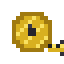 **Measuring Tape**

## Amethyst chests

### Amethyst Chest

<table><tr><td>

<table>
<tr><td align="center" width="72">Amethyst Shard</td><td align="center" width="72">Copper Ingot</td><td align="center" width="72">Amethyst Shard</td></tr>
<tr><td align="center" width="72">Copper Ingot</td><td align="center" width="72">Chest</td><td align="center" width="72">Copper Ingot</td></tr>
<tr><td align="center" width="72">Amethyst Shard</td><td align="center" width="72">Copper Ingot</td><td align="center" width="72">Amethyst Shard</td></tr>
</table>

</td><td align="center" width="40">➜</td><td align="center" width="96">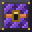 Amethyst Chest</td></tr></table>

### Crystal Chest

<table><tr><td>

<table>
<tr><td align="center" width="72">Block of Amethyst</td><td align="center" width="72">Iron Ingot</td><td align="center" width="72">Block of Amethyst</td></tr>
<tr><td align="center" width="72">Iron Ingot</td><td align="center" width="72"> Amethyst Chest</td><td align="center" width="72">Iron Ingot</td></tr>
<tr><td align="center" width="72">Block of Amethyst</td><td align="center" width="72">Iron Ingot</td><td align="center" width="72">Block of Amethyst</td></tr>
</table>

</td><td align="center" width="40">➜</td><td align="center" width="96">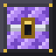 Crystal Chest</td></tr></table>

### Resonance Chest

<table><tr><td>

<table>
<tr><td align="center" width="72">Gold Ingot</td><td align="center" width="72">Diamond</td><td align="center" width="72">Gold Ingot</td></tr>
<tr><td align="center" width="72">Diamond</td><td align="center" width="72"> Crystal Chest</td><td align="center" width="72">Diamond</td></tr>
<tr><td align="center" width="72">Gold Ingot</td><td align="center" width="72">Diamond</td><td align="center" width="72">Gold Ingot</td></tr>
</table>

</td><td align="center" width="40">➜</td><td align="center" width="96">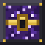 Resonance Chest</td></tr></table>

## Helpers and their homes

### Amethyst Sprite

<table><tr><td>

<table>
<tr><td align="center" width="72">Block of Amethyst</td><td align="center" width="72">Eye of Ender</td><td align="center" width="72">Block of Amethyst</td></tr>
<tr><td align="center" width="72">Block of Amethyst</td><td align="center" width="72">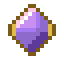 Amethyst Core</td><td align="center" width="72">Block of Amethyst</td></tr>
<tr><td align="center" width="72">Block of Amethyst</td><td align="center" width="72">Block of Redstone</td><td align="center" width="72">Block of Amethyst</td></tr>
</table>

</td><td align="center" width="40">➜</td><td align="center" width="96"> Amethyst Sprite</td></tr></table>

### Watch Moth

<table><tr><td>

<table>
<tr><td align="center" width="72">Phantom Membrane</td><td align="center" width="72">Spyglass</td><td align="center" width="72">Phantom Membrane</td></tr>
<tr><td align="center" width="72">Glow Ink Sac</td><td align="center" width="72"> Amethyst Core</td><td align="center" width="72">Glow Ink Sac</td></tr>
<tr><td align="center" width="72">Phantom Membrane</td><td align="center" width="72">Lantern</td><td align="center" width="72">Phantom Membrane</td></tr>
</table>

</td><td align="center" width="40">➜</td><td align="center" width="96"> Watch Moth</td></tr></table>

### Storage Griffin

<table><tr><td>

<table>
<tr><td align="center" width="72">Phantom Membrane</td><td align="center" width="72"> Amethyst Core</td><td align="center" width="72">Phantom Membrane</td></tr>
<tr><td align="center" width="72">Feather</td><td align="center" width="72">Ender Chest</td><td align="center" width="72">Feather</td></tr>
<tr><td align="center" width="72">Feather</td><td align="center" width="72">Saddle</td><td align="center" width="72">Feather</td></tr>
</table>

</td><td align="center" width="40">➜</td><td align="center" width="96"> Storage Griffin</td></tr></table>

### Spark Beetle

<table><tr><td>

<table>
<tr><td align="center" width="72">Block of Redstone</td><td align="center" width="72">Lightning Rod</td><td align="center" width="72">Block of Redstone</td></tr>
<tr><td align="center" width="72">Block of Copper</td><td align="center" width="72"> Amethyst Core</td><td align="center" width="72">Block of Copper</td></tr>
<tr><td align="center" width="72">Block of Copper</td><td align="center" width="72">Block of Amethyst</td><td align="center" width="72">Block of Copper</td></tr>
</table>

</td><td align="center" width="40">➜</td><td align="center" width="96"> Spark Beetle</td></tr></table>

### Chel

<table><tr><td>

<table>
<tr><td align="center" width="72">Block of Amethyst</td><td align="center" width="72"> Amethyst Core</td><td align="center" width="72">Block of Amethyst</td></tr>
<tr><td align="center" width="72">Cookie</td><td align="center" width="72">Crafter</td><td align="center" width="72">Cookie</td></tr>
<tr><td align="center" width="72">Polished Deepslate</td><td align="center" width="72">Block of Redstone</td><td align="center" width="72">Polished Deepslate</td></tr>
</table>

</td><td align="center" width="40">➜</td><td align="center" width="96"> Chel</td></tr></table>

### Ashley

<table><tr><td>

<table>
<tr><td align="center" width="72">Block of Coal</td><td align="center" width="72"> Amethyst Core</td><td align="center" width="72">Block of Coal</td></tr>
<tr><td align="center" width="72">Mud</td><td align="center" width="72">Campfire</td><td align="center" width="72">Mud</td></tr>
<tr><td align="center" width="72">Block of Coal</td><td align="center" width="72">Mud</td><td align="center" width="72">Block of Coal</td></tr>
</table>

</td><td align="center" width="40">➜</td><td align="center" width="96"> Ashley</td></tr></table>

### Amethyst Fox

<table><tr><td>

<table>
<tr><td align="center" width="72">Block of Amethyst</td><td align="center" width="72">Glow Berries</td><td align="center" width="72">Block of Amethyst</td></tr>
<tr><td align="center" width="72">Block of Lapis Lazuli</td><td align="center" width="72"> Amethyst Core</td><td align="center" width="72">Block of Lapis Lazuli</td></tr>
<tr><td align="center" width="72">Block of Amethyst</td><td align="center" width="72">Book</td><td align="center" width="72">Block of Amethyst</td></tr>
</table>

</td><td align="center" width="40">➜</td><td align="center" width="96"> Amethyst Fox</td></tr></table>

### Helper Bed

<table><tr><td>

<table>
<tr><td align="center" width="72">Amethyst Shard</td><td align="center" width="72"></td><td align="center" width="72"></td></tr>
<tr><td align="center" width="72">any Wool</td><td align="center" width="72">any Wool</td><td align="center" width="72">Gold Nugget</td></tr>
<tr><td align="center" width="72">any Planks</td><td align="center" width="72">any Planks</td><td align="center" width="72">any Planks</td></tr>
</table>

</td><td align="center" width="40">➜</td><td align="center" width="96"> Helper Bed</td></tr></table>

### Wolf Basket

<table><tr><td>

<table>
<tr><td align="center" width="72">Stick</td><td align="center" width="72"></td><td align="center" width="72">Stick</td></tr>
<tr><td align="center" width="72">Wheat</td><td align="center" width="72">any Wool</td><td align="center" width="72">Wheat</td></tr>
<tr><td align="center" width="72">Wheat</td><td align="center" width="72">Amethyst Shard</td><td align="center" width="72">Wheat</td></tr>
</table>

</td><td align="center" width="40">➜</td><td align="center" width="96">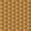 Wolf Basket</td></tr></table>

### Amethyst Bone

<table><tr><td>

<table>
<tr><td align="center" width="72">Glowstone Dust</td><td align="center" width="72">Amethyst Shard</td><td align="center" width="72">Glowstone Dust</td></tr>
<tr><td align="center" width="72">Amethyst Shard</td><td align="center" width="72">Bone</td><td align="center" width="72">Amethyst Shard</td></tr>
<tr><td align="center" width="72">Glowstone Dust</td><td align="center" width="72">Amethyst Shard</td><td align="center" width="72">Glowstone Dust</td></tr>
</table>

</td><td align="center" width="40">➜</td><td align="center" width="96">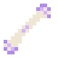 Amethyst Bone</td></tr></table>

### Dragon Heart

<table><tr><td>

<table>
<tr><td align="center" width="72">Dragon's Breath</td><td align="center" width="72"> Crystal Obsidian</td><td align="center" width="72">Dragon's Breath</td></tr>
<tr><td align="center" width="72">Block of Amethyst</td><td align="center" width="72">Nether Star</td><td align="center" width="72">Block of Amethyst</td></tr>
<tr><td align="center" width="72">Dragon's Breath</td><td align="center" width="72">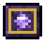 Amethyst Obsidian Upgrade</td><td align="center" width="72">Dragon's Breath</td></tr>
</table>

</td><td align="center" width="40">➜</td><td align="center" width="96">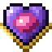 Dragon Heart</td></tr></table>

## Phoenix mail and travel

### Phoenix

<table><tr><td>

<table>
<tr><td align="center" width="72">Blaze Rod</td><td align="center" width="72">Block of Gold</td><td align="center" width="72">Blaze Rod</td></tr>
<tr><td align="center" width="72">Feather</td><td align="center" width="72">Totem of Undying</td><td align="center" width="72">Feather</td></tr>
<tr><td align="center" width="72">Blaze Rod</td><td align="center" width="72"> Amethyst Core</td><td align="center" width="72">Blaze Rod</td></tr>
</table>

</td><td align="center" width="40">➜</td><td align="center" width="96"> Phoenix</td></tr></table>

### Phoenix Nest

<table><tr><td>

<table>
<tr><td align="center" width="72">Stick</td><td align="center" width="72">Block of Amethyst</td><td align="center" width="72">Stick</td></tr>
<tr><td align="center" width="72">Hay Bale</td><td align="center" width="72">Barrel</td><td align="center" width="72">Hay Bale</td></tr>
<tr><td align="center" width="72">Stick</td><td align="center" width="72">Stick</td><td align="center" width="72">Stick</td></tr>
</table>

</td><td align="center" width="40">➜</td><td align="center" width="96">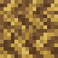 Phoenix Nest</td></tr></table>

### Phoenix Stop

<table><tr><td>

<table>
<tr><td align="center" width="72"></td><td align="center" width="72">Amethyst Shard</td><td align="center" width="72"></td></tr>
<tr><td align="center" width="72">Gold Ingot</td><td align="center" width="72">Lodestone</td><td align="center" width="72">Gold Ingot</td></tr>
<tr><td align="center" width="72">Polished Deepslate</td><td align="center" width="72">Polished Deepslate</td><td align="center" width="72">Polished Deepslate</td></tr>
</table>

</td><td align="center" width="40">➜</td><td align="center" width="96"> Phoenix Stop</td></tr></table>

### Flight Plan

**Shapeless:** Paper + Feather + Amethyst Shard + Ender Pearl ➜ 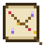 **Flight Plan**

### Signal Lantern

<table><tr><td>

<table>
<tr><td align="center" width="72"></td><td align="center" width="72">Gold Nugget</td><td align="center" width="72"></td></tr>
<tr><td align="center" width="72">Polished Deepslate</td><td align="center" width="72">Amethyst Shard</td><td align="center" width="72">Polished Deepslate</td></tr>
<tr><td align="center" width="72">Polished Deepslate</td><td align="center" width="72">Redstone Dust</td><td align="center" width="72">Polished Deepslate</td></tr>
</table>

</td><td align="center" width="40">➜</td><td align="center" width="96">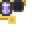 Signal Lantern</td></tr></table>

## Farm tools

### Amethyst Hopper

<table><tr><td>

<table>
<tr><td align="center" width="72">Amethyst Shard</td><td align="center" width="72"></td><td align="center" width="72">Amethyst Shard</td></tr>
<tr><td align="center" width="72"></td><td align="center" width="72">Hopper</td><td align="center" width="72"></td></tr>
<tr><td align="center" width="72"></td><td align="center" width="72">Gold Ingot</td><td align="center" width="72"></td></tr>
</table>

</td><td align="center" width="40">➜</td><td align="center" width="96"> Amethyst Hopper</td></tr></table>

### Crystal Pusher

<table><tr><td>

<table>
<tr><td align="center" width="72"></td><td align="center" width="72">Amethyst Shard</td><td align="center" width="72"></td></tr>
<tr><td align="center" width="72">Gold Ingot</td><td align="center" width="72">Dropper</td><td align="center" width="72">Amethyst Shard</td></tr>
</table>

</td><td align="center" width="40">➜</td><td align="center" width="96">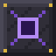 Crystal Pusher</td></tr></table>

### Block Placer

<table><tr><td>

<table>
<tr><td align="center" width="72">Cobbled Deepslate</td><td align="center" width="72">Cobbled Deepslate</td><td align="center" width="72">Cobbled Deepslate</td></tr>
<tr><td align="center" width="72">Cobbled Deepslate</td><td align="center" width="72">Piston</td><td align="center" width="72">Cobbled Deepslate</td></tr>
<tr><td align="center" width="72">Cobbled Deepslate</td><td align="center" width="72">Redstone Dust</td><td align="center" width="72">Cobbled Deepslate</td></tr>
</table>

</td><td align="center" width="40">➜</td><td align="center" width="96">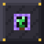 Block Placer</td></tr></table>

### Crystal Conveyor

<table><tr><td>

<table>
<tr><td align="center" width="72">Amethyst Shard</td><td align="center" width="72">Amethyst Shard</td><td align="center" width="72">Amethyst Shard</td></tr>
<tr><td align="center" width="72">Iron Ingot</td><td align="center" width="72">Redstone Dust</td><td align="center" width="72">Iron Ingot</td></tr>
</table>

</td><td align="center" width="40">➜</td><td align="center" width="96">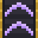 Crystal Conveyor <b>×8</b></td></tr></table>

### Fast Crystal Conveyor

<table><tr><td>

<table>
<tr><td align="center" width="72"> Crystal Conveyor</td><td align="center" width="72"> Crystal Conveyor</td><td align="center" width="72"> Crystal Conveyor</td></tr>
<tr><td align="center" width="72"> Crystal Conveyor</td><td align="center" width="72"> Glow Crystal</td><td align="center" width="72"> Crystal Conveyor</td></tr>
<tr><td align="center" width="72"> Crystal Conveyor</td><td align="center" width="72"> Crystal Conveyor</td><td align="center" width="72"> Crystal Conveyor</td></tr>
</table>

</td><td align="center" width="40">➜</td><td align="center" width="96"> Fast Crystal Conveyor <b>×8</b></td></tr></table>

### Crystal Sorter

<table><tr><td>

<table>
<tr><td align="center" width="72"></td><td align="center" width="72">Amethyst Shard</td><td align="center" width="72"></td></tr>
<tr><td align="center" width="72"> Crystal Conveyor</td><td align="center" width="72">Hopper</td><td align="center" width="72"> Crystal Conveyor</td></tr>
<tr><td align="center" width="72"></td><td align="center" width="72">Redstone Comparator</td><td align="center" width="72"></td></tr>
</table>

</td><td align="center" width="40">➜</td><td align="center" width="96">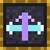 Crystal Sorter</td></tr></table>

### Farm Monitor

<table><tr><td>

<table>
<tr><td align="center" width="72"></td><td align="center" width="72">Glass Pane</td><td align="center" width="72"></td></tr>
<tr><td align="center" width="72">Gold Ingot</td><td align="center" width="72">Observer</td><td align="center" width="72">Gold Ingot</td></tr>
<tr><td align="center" width="72"></td><td align="center" width="72">Amethyst Shard</td><td align="center" width="72"></td></tr>
</table>

</td><td align="center" width="40">➜</td><td align="center" width="96"> Farm Monitor</td></tr></table>

### Chunk Loader

<table><tr><td>

<table>
<tr><td align="center" width="72">Polished Deepslate</td><td align="center" width="72">Glass</td><td align="center" width="72">Polished Deepslate</td></tr>
<tr><td align="center" width="72">Gold Ingot</td><td align="center" width="72">Block of Diamond</td><td align="center" width="72">Gold Ingot</td></tr>
<tr><td align="center" width="72">Polished Deepslate</td><td align="center" width="72">Polished Deepslate</td><td align="center" width="72">Polished Deepslate</td></tr>
</table>

</td><td align="center" width="40">➜</td><td align="center" width="96">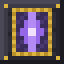 Chunk Loader</td></tr></table>

## Crystal Depths

### Polished Crystal Stone

<table><tr><td>

<table>
<tr><td align="center" width="72">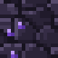 Crystal Stone</td><td align="center" width="72"> Crystal Stone</td></tr>
<tr><td align="center" width="72"> Crystal Stone</td><td align="center" width="72"> Crystal Stone</td></tr>
</table>

</td><td align="center" width="40">➜</td><td align="center" width="96">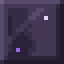 Polished Crystal Stone <b>×4</b></td></tr></table>

### Polished Crystal Stone

### Crystal Stone Bricks

<table><tr><td>

<table>
<tr><td align="center" width="72"> Polished Crystal Stone</td><td align="center" width="72"> Polished Crystal Stone</td></tr>
<tr><td align="center" width="72"> Polished Crystal Stone</td><td align="center" width="72"> Polished Crystal Stone</td></tr>
</table>

</td><td align="center" width="40">➜</td><td align="center" width="96"> Crystal Stone Bricks <b>×4</b></td></tr></table>

### Crystal Stone Bricks

### Crystal Stone Bricks

### Cracked Crystal Stone Bricks

### Chiseled Crystal Stone

<table><tr><td>

<table>
<tr><td align="center" width="72"> Crystal Stone Brick Slab</td></tr>
<tr><td align="center" width="72"> Crystal Stone Brick Slab</td></tr>
</table>

</td><td align="center" width="40">➜</td><td align="center" width="96">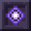 Chiseled Crystal Stone</td></tr></table>

### Chiseled Crystal Stone

### Chiseled Crystal Stone

### Chiseled Crystal Stone

### Crystal Stone Brick Stairs

<table><tr><td>

<table>
<tr><td align="center" width="72"> Crystal Stone Bricks</td><td align="center" width="72"></td><td align="center" width="72"></td></tr>
<tr><td align="center" width="72"> Crystal Stone Bricks</td><td align="center" width="72"> Crystal Stone Bricks</td><td align="center" width="72"></td></tr>
<tr><td align="center" width="72"> Crystal Stone Bricks</td><td align="center" width="72"> Crystal Stone Bricks</td><td align="center" width="72"> Crystal Stone Bricks</td></tr>
</table>

</td><td align="center" width="40">➜</td><td align="center" width="96"> Crystal Stone Brick Stairs <b>×4</b></td></tr></table>

### Crystal Stone Brick Stairs

### Crystal Stone Brick Stairs

### Crystal Stone Brick Stairs

### Crystal Stone Brick Slab

<table><tr><td>

<table>
<tr><td align="center" width="72"> Crystal Stone Bricks</td><td align="center" width="72"> Crystal Stone Bricks</td><td align="center" width="72"> Crystal Stone Bricks</td></tr>
</table>

</td><td align="center" width="40">➜</td><td align="center" width="96"> Crystal Stone Brick Slab <b>×6</b></td></tr></table>

### Crystal Stone Brick Slab

### Crystal Stone Brick Slab

### Crystal Stone Brick Slab

### Crystal Glass

<table><tr><td>

<table>
<tr><td align="center" width="72">Glass</td><td align="center" width="72">Glass</td><td align="center" width="72">Glass</td></tr>
<tr><td align="center" width="72">Glass</td><td align="center" width="72"> Glow Crystal</td><td align="center" width="72">Glass</td></tr>
<tr><td align="center" width="72">Glass</td><td align="center" width="72">Glass</td><td align="center" width="72">Glass</td></tr>
</table>

</td><td align="center" width="40">➜</td><td align="center" width="96"> Crystal Glass <b>×8</b></td></tr></table>

### Crystal Lantern

<table><tr><td>

<table>
<tr><td align="center" width="72">Iron Nugget</td><td align="center" width="72">Iron Nugget</td><td align="center" width="72">Iron Nugget</td></tr>
<tr><td align="center" width="72">Iron Nugget</td><td align="center" width="72"> Glow Crystal</td><td align="center" width="72">Iron Nugget</td></tr>
<tr><td align="center" width="72">Iron Nugget</td><td align="center" width="72">Iron Nugget</td><td align="center" width="72">Iron Nugget</td></tr>
</table>

</td><td align="center" width="40">➜</td><td align="center" width="96">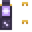 Crystal Lantern <b>×2</b></td></tr></table>

### Pure Amethyst

### Pure Amethyst

**Shapeless:** Block of Pure Amethyst ➜  **Pure Amethyst** <b>×9</b>

### Pure Amethyst

### Block of Pure Amethyst

<table><tr><td>

<table>
<tr><td align="center" width="72"> Pure Amethyst</td><td align="center" width="72"> Pure Amethyst</td><td align="center" width="72"> Pure Amethyst</td></tr>
<tr><td align="center" width="72"> Pure Amethyst</td><td align="center" width="72"> Pure Amethyst</td><td align="center" width="72"> Pure Amethyst</td></tr>
<tr><td align="center" width="72"> Pure Amethyst</td><td align="center" width="72"> Pure Amethyst</td><td align="center" width="72"> Pure Amethyst</td></tr>
</table>

</td><td align="center" width="40">➜</td><td align="center" width="96">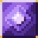 Block of Pure Amethyst</td></tr></table>

### Citrine Sandstone

<table><tr><td>

<table>
<tr><td align="center" width="72">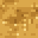 Citrine Sand</td><td align="center" width="72"> Citrine Sand</td></tr>
<tr><td align="center" width="72"> Citrine Sand</td><td align="center" width="72"> Citrine Sand</td></tr>
</table>

</td><td align="center" width="40">➜</td><td align="center" width="96">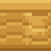 Citrine Sandstone</td></tr></table>

### White Crystal Wool

**Shapeless:** any Crystal Wool + White Dye ➜  **White Crystal Wool**

### Memory Case

<table><tr><td>

<table>
<tr><td align="center" width="72">Dark Oak Slab</td><td align="center" width="72">Dark Oak Slab</td><td align="center" width="72">Dark Oak Slab</td></tr>
<tr><td align="center" width="72"> Crystal Glass</td><td align="center" width="72">Amethyst Shard</td><td align="center" width="72"> Crystal Glass</td></tr>
<tr><td align="center" width="72">Gold Ingot</td><td align="center" width="72"> Polished Crystal Stone</td><td align="center" width="72">Gold Ingot</td></tr>
</table>

</td><td align="center" width="40">➜</td><td align="center" width="96">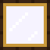 Memory Case</td></tr></table>

Crystal wool works like wool: any crystal wool + a dye gives that colour, and crystal wool turns back into string.

## Bosses and the End

### Resonance Igniter

<table><tr><td>

<table>
<tr><td align="center" width="72">Block of Amethyst</td><td align="center" width="72">Ghast Tear</td><td align="center" width="72">Block of Amethyst</td></tr>
<tr><td align="center" width="72">Diamond</td><td align="center" width="72">Glass Bottle</td><td align="center" width="72">Diamond</td></tr>
<tr><td align="center" width="72">Block of Amethyst</td><td align="center" width="72">Block of Redstone</td><td align="center" width="72">Block of Amethyst</td></tr>
</table>

</td><td align="center" width="40">➜</td><td align="center" width="96"> Resonance Igniter</td></tr></table>

### Lair Compass

<table><tr><td>

<table>
<tr><td align="center" width="72">Amethyst Shard</td><td align="center" width="72">Eye of Ender</td><td align="center" width="72">Amethyst Shard</td></tr>
<tr><td align="center" width="72">Popped Chorus Fruit</td><td align="center" width="72">Compass</td><td align="center" width="72">Popped Chorus Fruit</td></tr>
<tr><td align="center" width="72">Amethyst Shard</td><td align="center" width="72">Eye of Ender</td><td align="center" width="72">Amethyst Shard</td></tr>
</table>

</td><td align="center" width="40">➜</td><td align="center" width="96">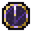 Lair Compass</td></tr></table>

### Crystal Cocoon

<table><tr><td>

<table>
<tr><td align="center" width="72">String</td><td align="center" width="72">Block of Amethyst</td><td align="center" width="72">String</td></tr>
<tr><td align="center" width="72">Crying Obsidian</td><td align="center" width="72">Fermented Spider Eye</td><td align="center" width="72">Crying Obsidian</td></tr>
<tr><td align="center" width="72">String</td><td align="center" width="72">Eye of Ender</td><td align="center" width="72">String</td></tr>
</table>

</td><td align="center" width="40">➜</td><td align="center" width="96">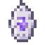 Crystal Cocoon</td></tr></table>

### Crystal Obsidian

<table><tr><td>

<table>
<tr><td align="center" width="72">Crying Obsidian</td><td align="center" width="72">Block of Amethyst</td><td align="center" width="72">Crying Obsidian</td></tr>
<tr><td align="center" width="72">Block of Amethyst</td><td align="center" width="72">Netherite Scrap</td><td align="center" width="72">Block of Amethyst</td></tr>
<tr><td align="center" width="72">Crying Obsidian</td><td align="center" width="72">Block of Amethyst</td><td align="center" width="72">Crying Obsidian</td></tr>
</table>

</td><td align="center" width="40">➜</td><td align="center" width="96"> Crystal Obsidian</td></tr></table>

## Amethyst Obsidian gear

### Amethyst Obsidian Helmet

**Smithing table:** Amethyst Obsidian Upgrade + Netherite Helmet + Crystal Obsidian ➜ 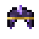 **Amethyst Obsidian Helmet**

### Amethyst Obsidian Chestplate

**Smithing table:** Amethyst Obsidian Upgrade + Netherite Chestplate + Crystal Obsidian ➜  **Amethyst Obsidian Chestplate**

### Amethyst Obsidian Leggings

**Smithing table:** Amethyst Obsidian Upgrade + Netherite Leggings + Crystal Obsidian ➜ 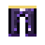 **Amethyst Obsidian Leggings**

### Amethyst Obsidian Boots

**Smithing table:** Amethyst Obsidian Upgrade + Netherite Boots + Crystal Obsidian ➜ 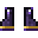 **Amethyst Obsidian Boots**

### Amethyst Obsidian Sword

**Smithing table:** Amethyst Obsidian Upgrade + Netherite Sword + Crystal Obsidian ➜  **Amethyst Obsidian Sword**

### Amethyst Obsidian Pickaxe

**Smithing table:** Amethyst Obsidian Upgrade + Netherite Pickaxe + Crystal Obsidian ➜ 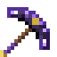 **Amethyst Obsidian Pickaxe**

### Amethyst Obsidian Axe

**Smithing table:** Amethyst Obsidian Upgrade + Netherite Axe + Crystal Obsidian ➜ 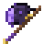 **Amethyst Obsidian Axe**

### Amethyst Obsidian Shovel

**Smithing table:** Amethyst Obsidian Upgrade + Netherite Shovel + Crystal Obsidian ➜  **Amethyst Obsidian Shovel**

### Amethyst Obsidian Hoe

**Smithing table:** Amethyst Obsidian Upgrade + Netherite Hoe + Crystal Obsidian ➜ 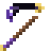 **Amethyst Obsidian Hoe**

### Crystal Forge

<table><tr><td>

<table>
<tr><td align="center" width="72"> Pure Amethyst</td><td align="center" width="72"> Pure Amethyst</td><td align="center" width="72"> Pure Amethyst</td></tr>
<tr><td align="center" width="72">Polished Deepslate</td><td align="center" width="72">Smithing Table</td><td align="center" width="72">Polished Deepslate</td></tr>
<tr><td align="center" width="72">Polished Deepslate</td><td align="center" width="72">Anvil</td><td align="center" width="72">Polished Deepslate</td></tr>
</table>

</td><td align="center" width="40">➜</td><td align="center" width="96"> Crystal Forge</td></tr></table>

## Backpacks

### Leather Backpack

<table><tr><td>

<table>
<tr><td align="center" width="72">Leather</td><td align="center" width="72">String</td><td align="center" width="72">Leather</td></tr>
<tr><td align="center" width="72">Leather</td><td align="center" width="72">Chest</td><td align="center" width="72">Leather</td></tr>
<tr><td align="center" width="72">Leather</td><td align="center" width="72">Leather</td><td align="center" width="72">Leather</td></tr>
</table>

</td><td align="center" width="40">➜</td><td align="center" width="96"> Leather Backpack</td></tr></table>

### Iron Backpack

**Crafting grid (shapeless):** Leather Backpack + Block of Iron ➜  **Iron Backpack** — contents and enchantments are kept

### Gold Backpack

**Crafting grid (shapeless):** Iron Backpack + Block of Gold ➜  **Gold Backpack** — contents and enchantments are kept

### Diamond Backpack

**Crafting grid (shapeless):** Gold Backpack + Block of Diamond ➜  **Diamond Backpack** — contents and enchantments are kept

### Netherite Backpack

**Smithing table:** Netherite Upgrade (Smithing Template) + Diamond Backpack + Netherite Ingot ➜  **Netherite Backpack**

Backpacks can be **dyed** in the crafting grid like leather armor (backpack + any dye).

## Companions

### Resonance Treat

**Shapeless:** Honey Bottle + Amethyst Shard + Amethyst Shard ➜  **Resonance Treat** <b>×4</b>

## Books

### Storage Handbook

**Shapeless:** Book + Amethyst Shard ➜  **Storage Handbook**

### Recipe Book

**Shapeless:** Book + Amethyst Shard + Crafting Table ➜  **Recipe Book**

### Bestiary

**Shapeless:** Book + Amethyst Shard + Feather ➜  **Bestiary**

### Item Lexicon

**Shapeless:** Book + Amethyst Shard + Item Frame ➜  **Item Lexicon**

### Crystal Chronicle

**Shapeless:** Book + Amethyst Shard + Eye of Ender ➜  **Crystal Chronicle**

### Chel's Joke Book

**Shapeless:** Book + Amethyst Shard + Cookie ➜  **Chel's Joke Book**

## Extra vanilla recipes

Recipes the mod adds for vanilla items.

### Cyan Dye

**Shapeless:** Azure Crystal Cluster ➜ **Cyan Dye**

### Cyan Dye

**Shapeless:** Azure Crystal ➜ **Cyan Dye** <b>×2</b>

### Pink Dye

**Shapeless:** Rose Quartz Bloom ➜ **Pink Dye**

### Pink Dye

**Shapeless:** Rose Crystal Cluster ➜ **Pink Dye**

### Pink Dye

**Shapeless:** Rose Crystal ➜ **Pink Dye** <b>×2</b>

### Nether Quartz

**Shapeless:** Block of Quartz ➜ **Nether Quartz** <b>×4</b>

### String

**Shapeless:** any Crystal Wool ➜ **String** <b>×4</b>

### Yellow Dye

**Shapeless:** Citrine Crystal Cluster ➜ **Yellow Dye**

### Yellow Dye

**Shapeless:** Citrine Crystal ➜ **Yellow Dye** <b>×2</b>

## Items without a recipe

| Item | Where it comes from |
|---|---|
|  Amethyst Core | Amethyst Robot (30 % per kill, or a Wireless Core), Storm Herald (sometimes) |
|  Wireless Core | Amethyst Robot (30 % per kill, or an Amethyst Core) |
|  Range / Capacity Upgrade (Iron) | Amethyst Robot (always) |
|  Amethyst Obsidian Upgrade | Great Amethyst Spider (exactly one per kill) |
|  Peter Chel Parker | Right-click Chel with a nether star |
|  Cheldrogan | Right-click Peter Chel Parker with a Dragon Heart |
|  Amethyst Phoenix | Right-click a Phoenix with an Amethyst Obsidian Upgrade |
|  Crystal Wolf | Feed a tamed wolf an Amethyst Core |
|  Moon Wolf | Appears at full moon once you have 5 Crystal Wolves; win it over with an Amethyst Bone |
| Crystal enchantment books | Amethyst Fox (digs one up about every three days) |
|  Storage Master's Hammer | The Last Storage Master |
| Companions | Geode Keeper in amethyst geodes |

---

[← Books and interface](12-books-and-interface.md) · [Guide overview](README.md) · Next: [Controls and commands →](14-controls-and-commands.md)
