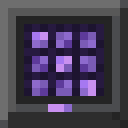

  

<h1 align="center">JTechStorage Guide</h1>

  Everything about the mod in one place: what each block, item and creature does, how to get it and how to use it.

---

This guide covers JTechStorage **0.25** for Minecraft **26.3 (Fabric)**. New here? Start with
[Getting started](01-getting-started.md). Looking for something specific? Use the table of contents or the quick answers
below. In game, the **Storage Handbook** and the other [books](12-books-and-interface.md) contain the same information.

## Contents

| | Page | What's inside |
|---|---|---|
| 🚀 | [Getting started](01-getting-started.md) | Installation, your first network, a roadmap through the mod |
| 📦 | [Storage network](02-storage-network.md) | Terminals, Storage Key, upgrades, search, sorting rules, statistics, wireless, resonance |
| 👥 | [Teams and trade](03-teams-and-trade.md) | Team Terminal, roles, channels, Trade Terminal |
| 🧚 | [Helpers](04-helpers.md) | Sprite, Watch Moth, Griffin, Spark Beetle, Chel, Peter, Ashley, Fox, wolves, beds, cosmetics |
| 🐉 | [Cheldrogan](05-cheldrogan.md) | The rideable crystal serpent dragon |
| 🔥 | [Phoenix mail and travel](06-phoenix.md) | Phoenix Nest, parcels, Amethyst Phoenix, stops, flight plan, Signal Lantern |
| 🦗 | [Companions](07-companions.md) | Geode Keeper and his trades, Shadow Mantis, Amethyst Shroom, Night Raven, menu, talents, HUD |
| ⛈️ | [Resonance Storm](08-resonance-storm.md) | When it starts, the waves, the Storm Herald, how to defend |
| ⚔️ | [Bosses and the End](09-bosses-and-end.md) | Amethyst Robot, Crystal Lair, Great Amethyst Spider, Amethyst Obsidian gear |
| 🦊 | [Crystal enchantments](10-crystal-enchantments.md) | The Amethyst Fox and its five enchantments |
| 🎒 | [Backpacks](11-backpacks.md) | Tiers, upgrading, wearing and placing |
| 📚 | [Books and interface](12-books-and-interface.md) | The six books, UI settings, JEI, advancements |
| 🛠️ | [Recipes](13-recipes.md) | Every recipe with pictures, plus items that have no recipe |
| 🎮 | [Controls and commands](14-controls-and-commands.md) | All keys, mouse actions and commands on one page |
| ⚙️ | [Configuration](15-configuration.md) | Every option of `config/jtechstorage.json` |

## Quick answers

| I want to … | Read |
|---|---|
| link my chests into one network | [Storage network → First network](02-storage-network.md#your-first-network) |
| get more range or more chests | [Storage network → Upgrades](02-storage-network.md#upgrades) |
| make a chest accept only one item | [Storage network → Sorting rules](02-storage-network.md#sorting-rules) |
| open my storage from anywhere | [Storage network → Wireless Terminal](02-storage-network.md#wireless-terminal) |
| get an **Amethyst Core** | [Bosses → Amethyst Robot](09-bosses-and-end.md#amethyst-robot) or the [Geode Keeper](07-companions.md#trading-with-the-geode-keeper) |
| have my chests sorted automatically | [Helpers → Amethyst Sprite](04-helpers.md#amethyst-sprite) |
| craft things automatically | [Helpers → Chel](04-helpers.md#chel) |
| protect my base | [Helpers → Peter Chel Parker](04-helpers.md#peter-chel-parker), [Crystal Wolf](04-helpers.md#crystal-wolf), [Watch Moth](04-helpers.md#watch-moth) |
| send items to a friend | [Phoenix mail](06-phoenix.md#phoenix-mail) |
| fly myself and cargo between places | [Amethyst Phoenix](06-phoenix.md#amethyst-phoenix) |
| find a companion | [Companions → Geode Keeper](07-companions.md#the-geode-keeper) |
| spend talent points | [Companions → Talent tree](07-companions.md#talent-tree) |
| know why a storm hit my base | [Resonance Storm → When does it start?](08-resonance-storm.md#when-does-it-start) |
| get gear stronger than netherite | [Amethyst Obsidian gear](09-bosses-and-end.md#amethyst-obsidian-gear) |
| get Double Jump or Sprint | [Crystal enchantments](10-crystal-enchantments.md) |
| change ranges, boss health or storm rules | [Configuration](15-configuration.md) |

## Good to know

- **Hold Shift** while hovering over any mod item to see its controls in the tooltip.
- **Every helper recipe** needs an **Amethyst Core**. The first ones come from the [Amethyst Robot](09-bosses-and-end.md#amethyst-robot).
- Nothing in the mod needs power or cables. **Resonance** is an optional bonus, the network always works without it.
- Companions and Crystal Wolves **cannot die** from normal damage: they become exhausted and recover. Peter and
  Cheldrogan fall back to their previous form instead of dying.
- The mod must be installed on **both server and client**. Language: English and German.

---

[Back to the README](../../README.md) · [Changelog](../../CHANGELOG.md)
